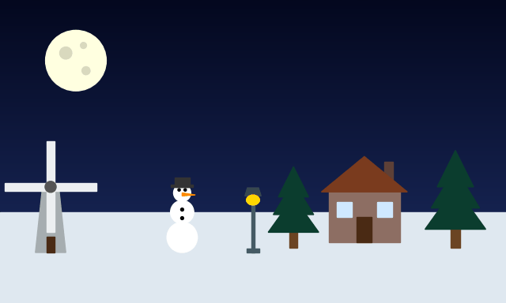

# cartoon2d

Draw and animate 2D cartoons with plain function calls. No axes, patches or figures to manage.

  
  

watch you can generate long video 

~~~python
from cartoon2d import *

NewScene("day")
DrawMountain("slategray", 70, 18)
DrawSun("gold", 85, 50)
car = DrawCar("royalblue", -12, 3)
Move(car, to=(112, 3), start=0, end=80, ease="linear")
Bounce(car, height=0.4, times=16, start=0, end=80)
Save("drive.gif")
~~~

Install: `pip install git+https://github.com/SUFIYAN2004/cartoon2d` (add `[svg]` for SVG import). Try it: `python -m cartoon2d`.

Canvas is 100 x 60, origin bottom-left, y up. Shapes are centred on `x` and sit on `y`.

## Draw
`DrawCar DrawSun DrawMoon DrawStar DrawHouse DrawTree DrawPine DrawCloud DrawMountain DrawFlower DrawFence
DrawPerson DrawBird DrawBoat DrawBalloon DrawRocket DrawFish DrawBall DrawRect DrawCircle DrawTriangle
DrawCube DrawSphere DrawWindmill DrawSnowman DrawLamp DrawUfo DrawText DrawSprite DrawSVG`

All: `DrawX(color, x, y, size=1, alpha=1, rot=0, flip=False, z=0, depth=0, shadow=False)`.
`DrawRect(..., w=10, h=5)`, `DrawCircle(..., r=3)`, `DrawTriangle(..., w=10, h=8)`, `DrawText(text, color, x, y)`,
`DrawSprite("cat.png", x, y, width=12)`.

## Animate (start and end are frame numbers; moves chain automatically)
| call | does |
|---|---|
| `Move(s, to=(x, y))` | glide to a point |
| `Path(s, points, by="length")` | follow a list of points (`by="index"` = one point per frame step) |
| `Orbit(s, center, radius, turns=1)` | circle around a point |
| `Rotate(s, to)` / `Spin(s, turns)` | rotate (degrees / full turns) |
| `Scale(s, to)` / `Fade(s, to)` / `Depth(s, to)` | grow, change opacity, move toward the horizon |
| `Bounce` / `Bob` / `Wiggle` | hop, float, shake (added on top of other motion) |
| `Walk(person, steps)` / `Drive(car, to)` / `Spin3D(cube, turns)` | walk cycle, wheels, 3D spin |
| `Say(text, x, y, start, end)` | caption that fades in and out |
| `Talk(s, text, start, end)` / `Dialogue(T, [(s, text), ...])` | speech bubbles |

Easing: `"linear"`, `"ease"`, `"in"`, `"out"`, `"bounce"`, or any function u -> u.

## Camera, depth, weather
`CameraMove`, `CameraZoom`, `Follow(shape)`, `Shake()`. `depth=` makes far things smaller and slower (parallax).
`shape.hud = True` ignores the camera. `Snow(n)`, `Rain(n)`, `Flash()`.

## 1,000+ shapes
~~~python
DrawShape("star_5_thin", "gold", 30, 40)     # any catalogue name
DrawShape("blob_17", "random", 60, 30)       # 'random' = pleasant colour
Find("flower"); Shapes("mandala")            # search / list names
Sheet("snowflake", n=40)                     # picture grid of a family
RandomShape(50, 30)
~~~
Families: polygon, star, gear, blob, rock, flower, burst, cross, pie, snowflake, crystal, puff, mandala, heart, bolt, arrow.

## Long videos and series
~~~python
cast = Cast(Mia=("Person", "orchid", 0.7), Max=("Person", "teal", 0.7))
ep = Episode("My Show", fps=15, width_px=480)
ep.card("Episode 1", seconds=3)

@ep.scene("Park", seconds=15)
def park(T):                                   # T converts seconds to frames
    mia, mx = cast.Mia(30, 11), cast.Max(60, 11)
    t = Dialogue(T, [(mia, "Hello Max!"), (mx, "Hi Mia!")], start=1)
    Move(mia, (80, 11), T(t), T(t + 4)); Walk(mia, 8, T(t), T(t + 4))

ep.estimate()          # time a few frames, predict total render time
ep.preview(1)          # filmstrip of one scene
ep.render()            # streams each scene to mp4 and joins them (resume=True after a crash)
~~~

## Output
`Show(t)`, `Save("x.gif" | "x.png" | "x.mp4")`, `Filmstrip(n)`, `Frames()`, `Gallery()`.
Themes: `NewScene("day" | "sunset" | "night" | "plain")`. MP4 needs ffmpeg.
