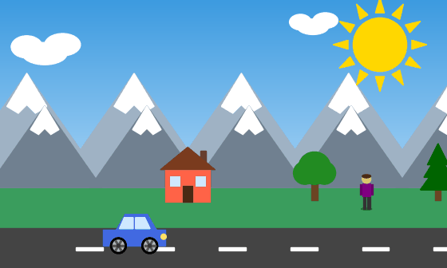

# cartoon2d


# install the library 
```python
pip install git+https://github.com/SUFIYAN2004/cartoon2d
```


Draw and animate 2D cartoons with plain function calls. No axes, patches or figures to manage.

```python
from cartoon2d import *

NewScene("day")
DrawMountain("slategray", 70, 18)
DrawSun("gold", 85, 50)
car = DrawCar("royalblue", -12, 3)
Move(car, to=(112, 3), start=0, end=80, ease="linear")
Bounce(car, height=0.4, times=16, start=0, end=80)
Save("drive.gif")
```

Canvas is 100 x 60, origin bottom-left, y up. Shapes are centred on `x` and sit on `y`.

## Draw
`DrawCar DrawSun DrawMoon DrawStar DrawHouse DrawTree DrawPine DrawCloud DrawMountain DrawFlower
DrawFence DrawPerson DrawBird DrawBoat DrawBalloon DrawRocket DrawFish DrawBall DrawRect DrawCircle
DrawTriangle DrawText`

All: `DrawX(color, x, y, size=1, alpha=1, rot=0, flip=False, z=0)`.
`DrawRect(..., w=10, h=5)`, `DrawCircle(..., r=3)`, `DrawTriangle(..., w=10, h=8)`, `DrawText(text, color, x, y)`.

## Animate (start and end are frame numbers; moves chain automatically)
| call | does |
|---|---|
| `Move(s, to=(x, y))` | glide to a point |
| `Path(s, points, by="length")` | follow a list of points (`by="index"` = one point per frame step) |
| `Orbit(s, center, radius, turns=1)` | circle around a point |
| `Rotate(s, to)` / `Spin(s, turns)` | rotate (degrees / full turns) |
| `Scale(s, to)` | grow or shrink |
| `Fade(s, to)` | change opacity (0 to 1) |
| `Bounce` / `Bob` / `Wiggle` | hop, float, shake (added on top of other motion) |
| `Say(text, x, y, start, end)` | caption that fades in and out |

Easing: `"linear"`, `"ease"`, `"in"`, `"out"`, `"bounce"`, or any function u -> u.

## Output
`Show(t)`, `Save("x.gif")`, `Save("x.png")`, `Filmstrip(n)`, `Frames()`, `Gallery()`.
Themes: `NewScene("day" | "sunset" | "night" | "plain")`.
## v0.3: depth, camera, 3D
```python
car = DrawCar("royalblue", 10, 3, shadow=True)   # shadow stays on the ground when the car hops
Drive(car, (330, 3), 0, 150)                     # moves AND spins the wheels
Follow(car, offset=(20, 0))                      # camera tracks the car
DrawMountain("#9fb2c4", 100, 18, 3, depth=6)     # far = smaller, slower (parallax)
cube = DrawCube("orange", 120, 11); Spin3D(cube, 3, 0, 150)
```
`depth` (0 = front), `Depth(s, to)`, `CameraMove`, `CameraZoom`, `Follow`, `Shake`, `Walk(person, steps)`,
`Drive(car, to)`, `Spin3D(cube, turns)`, `DrawCube`, `DrawSphere`. Set `shape.hud = True` to ignore the camera
(sun, clouds). Far layers need to cover more world: at depth d the visible range is camera x +- 50 * (1 + 0.25 d).
